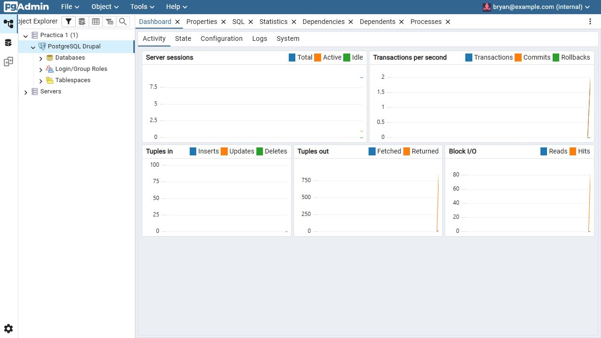
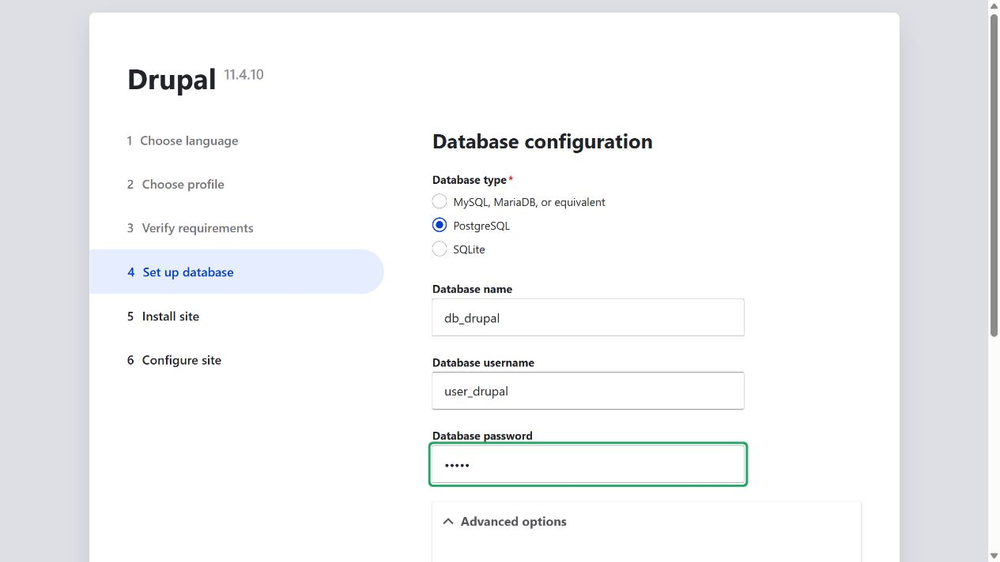
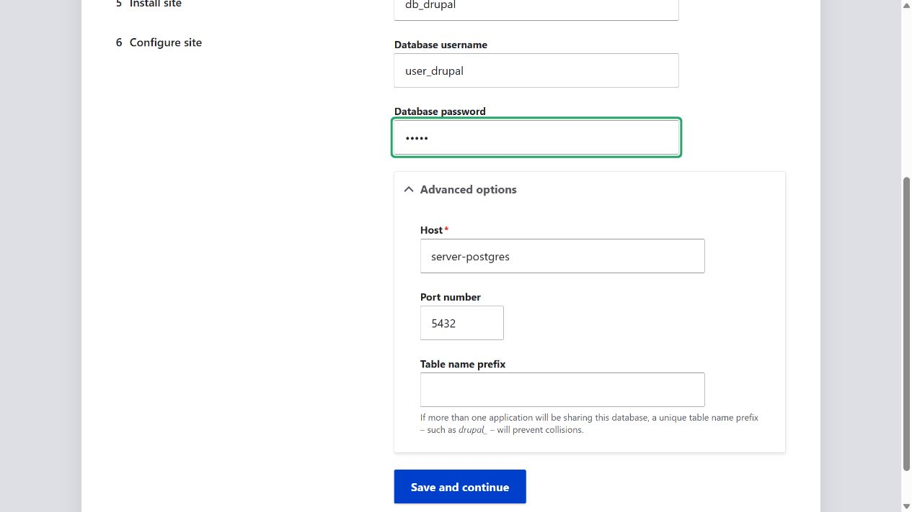
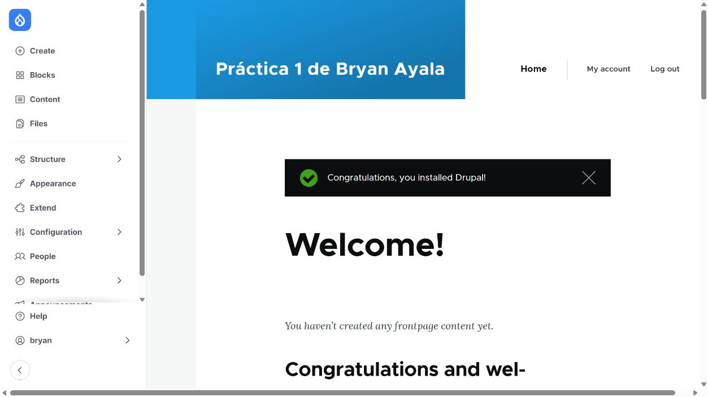
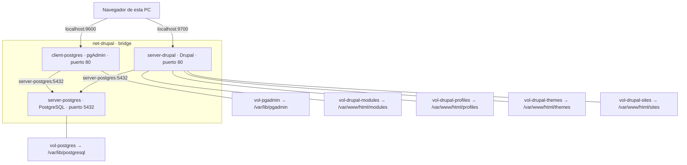

## VOLUMEN NOMBRADO
Un volumen nombrado (named volume) es un tipo de volumen gestionado por Docker que se almacena en una ubicación específica del sistema de archivos del host y se identifica mediante un nombre único. Los volúmenes nombrados no requieren que especifiques una ruta del sistema de archivos del host, y en su lugar, Docker se encarga de la gestión y el almacenamiento del volumen.


### Crear volumen
```
docker volume create <nombre volumen>
```

### Crear el volumen nombrado: vol-postgres
```powershell
docker volume create vol-postgres
```


## MOUNTPOINT
Un mountpoint se refiere al lugar en el sistema de archivos donde un dispositivo de almacenamiento se une (o monta) al sistema de archivos. Es el punto donde los archivos y directorios almacenados en ese dispositivo de almacenamiento son accesibles para el sistema operativo y las aplicaciones.

Por ejemplo, en Windows las unidades de almacenamiento (como `C:`, `D:`, etc.) actúan como puntos de montaje principales para discos duros, unidades flash, unidades ópticas y otros dispositivos de almacenamiento.

Cuando creas un volumen nombrado, Docker asigna un punto de montaje específico en el sistema de archivos del host para ese volumen.

### Estructura del Punto de Montaje:
- /var/lib/docker/volumes/: Es la ubicación habitual del driver local en el host Linux de Docker. En Docker Desktop para Windows está dentro de su máquina virtual Linux.
- nombreVolumen/: Es el nombre del volumen nombrado que has creado. Docker crea un directorio con este nombre dentro de /var/lib/docker/volumes/ para almacenar los datos del volumen.
- _data: Es el subdirectorio dentro de vol-postgres/ donde se almacenan los datos reales del volumen. El nombre _data es una convención utilizada por Docker para indicar el directorio donde se encuentran los datos del volumen.

### ¿Cómo acceder a ese Mountpoint?
`\\wsl$` permite ver los archivos de Linux desde el Explorador de Windows. La ruta `\\wsl.localhost\docker-desktop-data\data\docker\volumes` depende de cómo se instaló Docker Desktop. En esta PC esa ruta no existe.

Para ver la ruta del volumen se usa este comando

```powershell
docker volume inspect vol-postgres --format '{{.Mountpoint}}'
```

La ruta que apareció fue `/var/lib/docker/volumes/vol-postgres/_data`. Está dentro de la máquina Linux de Docker. Este otro comando permite ver sus archivos sin cambiarlos

```powershell
docker run --rm --mount type=volume,source=vol-postgres,target=/datos,readonly nginx:alpine ls -la /datos
```

### Crear un contenedor vinculado a un volumen nombrado
```
docker run -d --name <nombre contenedor> -v <nombre volumen>:<ruta contenedor> <nombre imagen>
```
ó
```
docker run -d --name <nombre contenedor> --mount type=volume,src=<nombre volumen>,dst=<ruta contenedor> <nombre imagen>
```
- destination, dst, target: La ruta donde se monta el archivo o directorio en el contenedor.
- source, src: El origen del montaje. Para volúmenes con nombre, este es el nombre del volumen. Para volúmenes anónimos, este campo se omite.


### Crear la red net-drupal de tipo bridge
```powershell
docker network create --driver bridge net-drupal
```

### Crear un servidor postgres vinculado a la red net-drupal, completar la ruta del contenedor
```
docker run -d --name server-postgres --mount type=volume,source=vol-postgres,target=/var/lib/postgresql -e POSTGRES_DB=db_drupal -e POSTGRES_PASSWORD=12345 -e POSTGRES_USER=user_drupal --network net-drupal postgres:18
```
_No es necesario exponer el puerto, debido a que nos vamos a conectar desde la misma red de docker_

Se usó PostgreSQL 18.6. Desde la versión 18 el volumen se monta en `/var/lib/postgresql`. Para Drupal también hace falta activar `pg_trgm`

```powershell
docker exec server-postgres pg_isready -U user_drupal -d db_drupal
docker exec server-postgres psql -U user_drupal -d db_drupal -c 'CREATE EXTENSION IF NOT EXISTS pg_trgm;'
```

Antes de ejecutar `psql` hay que esperar a que `pg_isready` diga que ya acepta conexiones.

La ruta se puede revisar en la [imagen oficial de PostgreSQL](https://hub.docker.com/_/postgres).

### Crear un cliente postgres vinculado a la red drupal a partir de la imagen dpage/pgadmin4, completar el correo
```
docker volume create vol-pgadmin
docker run -d --name client-postgres -p 9600:80 -e PGADMIN_DEFAULT_PASSWORD=54321 -e PGADMIN_DEFAULT_EMAIL=bryan@example.com --mount type=volume,source=vol-pgadmin,target=/var/lib/pgadmin --mount "type=bind,source=C:\Users\USER\Desktop\Practicas-Docker\practica1\config\pgadmin-servers.json,target=/pgadmin4/servers.json,readonly" --network net-drupal dpage/pgadmin4:latest
```

pgAdmin quedó en http://localhost:9600/. Se usó ese puerto porque WordPress ya ocupa el 9500. El archivo [pgadmin-servers.json](config/pgadmin-servers.json) carga los datos de conexión sin guardar la contraseña de PostgreSQL.

### Usar el cliente postgres para conectarse al servidor postgres, para la conexión usar el nombre del servidor en lugar de la dirección IP.

En pgAdmin se abre `Practica 1 > PostgreSQL Drupal` con estos datos

| Campo | Valor |
| --- | --- |
| Host | `server-postgres` |
| Puerto | `5432` |
| Base de datos | `db_drupal` |
| Usuario | `user_drupal` |
| Contraseña de la base de práctica | `12345` |

La conexión funcionó y apareció el panel del servidor.



### Crear los volúmenes necesarios para drupal, esto se puede encontrar en la documentación
```powershell
docker volume create vol-drupal-modules
docker volume create vol-drupal-profiles
docker volume create vol-drupal-themes
docker volume create vol-drupal-sites
```

### Crear el contenedor server-drupal vinculado a la red, usar la imagen drupal, y vincularlo a los volúmenes nombrados
```
docker run -d --name server-drupal -p 9700:80 -v vol-drupal-modules:/var/www/html/modules -v vol-drupal-profiles:/var/www/html/profiles -v vol-drupal-themes:/var/www/html/themes -v vol-drupal-sites:/var/www/html/sites --network net-drupal drupal:11-apache
```

### Ingrese al server-drupal y siga el paso a paso para la instalación.
Se abrió http://localhost:9700/, se eligió el perfil Standard y PostgreSQL como base de datos. En el paso 4 se usaron la base `db_drupal`, el usuario `user_drupal` y el host `server-postgres`.





Drupal 11.4.10 terminó de instalarse y el sitio quedó con el nombre Práctica 1 de Bryan Ayala.



_La instalación puede tomar varios minutos, mientras espera realice un diagrama de los contenedores que ha creado en este apartado._



### Eliminar un volumen específico
```
docker volume rm <nombre volumen>
```
**Considerar**
Datos Persistentes: Asegúrate de que el volumen no contiene datos críticos antes de eliminarlo, ya que esta operación no se puede deshacer.
Docker no deja borrar un volumen si un contenedor todavía lo usa, aunque esté detenido. Primero hay que borrar ese contenedor o recrearlo con otro montaje.

Esto se probó con un volumen que se podía borrar

```powershell
docker volume create vol-prueba-borrar
docker run --name prueba-volumen -v vol-prueba-borrar:/datos nginx:alpine sh -c 'echo prueba > /datos/prueba.txt'
docker volume rm vol-prueba-borrar
docker rm prueba-volumen
docker volume rm vol-prueba-borrar
```

Al intentar borrar el volumen apareció `volume is in use`, aunque el contenedor ya había terminado. Después de borrar `prueba-volumen` sí se pudo eliminar. Los volúmenes de PostgreSQL y Drupal se dejaron intactos.
